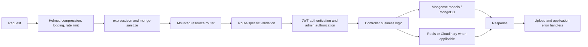

# Architecture

## Project structure

```text
app.js                         Express application and route mounting
server.js                      Environment loading, database connection, HTTPS startup
routes/                        Resource route definitions
controllers/                   Request handlers and business workflows
models/                        Mongoose schemas and models
middlewares/                   Authentication, authorization, validation, uploads, errors
config/                        MongoDB, Redis, Cloudinary, and test-database setup
utils/                         Shared helpers such as async error forwarding
tests/                         Unit, integration, and security tests
```

## Entry points

- `server.js` loads dotenv, connects to MongoDB, starts Redis connection, reads certificate files, and creates the HTTPS server.
- `app.js` creates the Express application, installs Helmet, compression, request logging, rate limiting, JSON parsing, Mongo sanitization, resource routers, upload routes, and error handlers.
- Tests import `app.js` directly and use `tests/setup.js` to connect to the test database.

## Request lifecycle



Route middleware order matters. For example, product mutations authenticate and authorize before uploading and validating an image-backed request; order creation authenticates before the controller starts its MongoDB transaction.

## Main interactions

- Authentication creates users with bcrypt-hashed passwords and returns seven-day JWTs.
- `protect` verifies a bearer token, loads a non-deleted user, and assigns it to `req.user`.
- `adminOnly` and `authorizeAdmin` restrict administrative operations based on `req.user.role`.
- Orders read a user cart, validate stock, create order and inventory records, decrement stock, delete the cart, and save an idempotency key in one transaction.
- Payment confirmation updates both payment and order status in one transaction.
- Product image uploads use Cloudinary-backed Multer storage.
- Redis stores the three rate-limit namespaces. `FallbackRateLimitStore` maintains local counters on every request and uses them during outages; when Redis responds, it enforces the higher of the local and shared counts. A background heartbeat detects idle connection failures.
